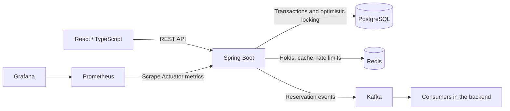
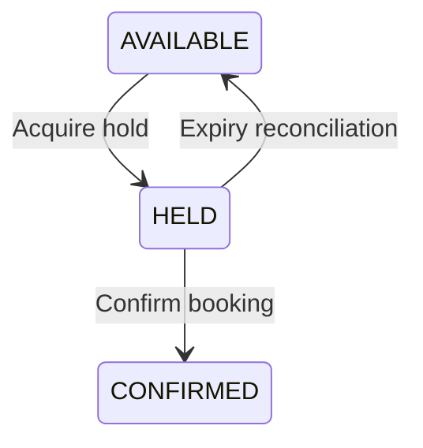

# SeatLock

**A Java and Spring Boot reservation project exploring concurrent seat holds, booking consistency, and backend observability.**

SeatLock models a venue ticketing workflow: browse an event, temporarily hold seats, and confirm a booking before the holds expire. It combines PostgreSQL transactions and optimistic locking with Redis-based holds, Kafka events, and a React interface.

The project is a personal learning and portfolio application. Session authentication, administrator catalogue management, server-owned pricing and durable demo payments are implemented. Payments are simulated; no real money is processed. A temporary public deployment is being prepared, but no live deployment is claimed yet.

See [reviewed local screenshots](docs/demo/README.md), [current project status](docs/project-status.md), and the [temporary deployment guide](docs/temporary-demo.md).

## Deployment

The prepared hosting stack is Vercel Hobby for the frontend, Render Free in Singapore for the Java backend, and Aiven Free PostgreSQL, Valkey and Kafka. `render.yaml` describes the backend; `deploy/backend.Dockerfile` builds it. Provider credentials belong in Render environment settings and secret files, never Git or frontend variables. Remote certificate trust and booking behaviour still require verification.

For a complete local container deployment, follow [the Docker deployment guide](docs/deployment.md). This uses `compose.deploy.yml`; the default `docker-compose.yml` remains the development infrastructure stack.

## Implemented features

- **Accounts and access:** BCrypt passwords, session login, CSRF protection, customer ownership checks and administrator-only endpoints.
- **Catalogue and pricing:** venues and layouts, private event drafts, editorial preview, publication, sales closure and server-owned price snapshots.
- **Demo payments:** durable success, failure and delayed-success flows with retry handling.
- **Reservation reliability:** recovery and release, payload-aware idempotency, transactional outbox publication and consumer deduplication.

- **Seat holds:** an atomic Redis Lua script creates a five-minute hold; the service records the `HELD` state and expiry in PostgreSQL.
- **Booking confirmation:** validates Redis hold ownership, creates a booking, updates seat state, and releases Redis holds. Repeated requests with an existing idempotency key return the stored booking.
- **Expiry reconciliation:** a scheduled job returns expired database holds to `AVAILABLE`, with a 30-second fixed delay between executions.
- **Concurrency controls:** JPA `@Version` optimistic locking on seats, Redis hold acquisition, and concurrent contention tests.
- **Seat-list caching:** Redis entries with a 45-second TTL, eviction calls on state changes, and a short-lived cache-repopulation lock to reduce duplicate database reads.
- **Rate limiting:** a Redis Lua-based limit of five hold requests per user ID per ten-second window, configurable in application properties.
- **Kafka events:** `seat-held`, `seat-confirmed`, and `seat-released` topics; consumer retry handling and dead-letter topics for confirmation and release events.
- **Resilience and monitoring:** Resilience4j circuit breakers, Micrometer metrics, Spring Boot Actuator, and Prometheus/Grafana configuration.
- **Frontend:** React/TypeScript pages for event browsing, seat selection, checkout, demo payment selection, booking confirmation, and operational dashboards.
- **Testing:** JUnit integration and concurrency tests, Testcontainers configuration, a Gatling simulation, and a smaller k6 hold script.

## Technology

| Area | Components |
| --- | --- |
| Backend | Java 21, Spring Boot 3.5.6, Spring Web, Spring Data JPA, Bean Validation |
| Persistence | PostgreSQL 16, Flyway |
| Coordination and caching | Redis 7, Lua scripts |
| Messaging | Spring Kafka, Confluent Kafka 7.6.0 with ZooKeeper in local Compose |
| Resilience | Resilience4j |
| Observability | Actuator, Micrometer, Prometheus, Grafana |
| Frontend | React, TypeScript, Vite, Tailwind CSS, Axios, TanStack Query, Zustand |
| Tests and tooling | JUnit 5, Testcontainers, Gatling, k6, Maven Wrapper, Docker Compose |

## Architecture

The backend runs as one Spring Boot application, with external PostgreSQL, Redis, and Kafka services.



The intended seat lifecycle is:



Redis operations are not part of the PostgreSQL transaction. Booking changes and outgoing event records are stored transactionally in PostgreSQL; an outbox worker publishes to Kafka and consumers deduplicate delivery. See [transaction hardening](docs/transaction-hardening.md) for the consistency boundaries.

## Run locally

### Prerequisites

- JDK 21, with `JAVA_HOME` configured.
- Docker Engine or Docker Desktop with Docker Compose support.
- Node.js and npm compatible with the Vite version in `frontend/package.json`.
- Git. Maven is provided through the repository's wrapper.

### 1. Clone and start infrastructure

```sh
git clone https://github.com/ShikharKothari0/SeatLock.git
cd SeatLock
docker compose up -d
docker compose ps
```

Compose starts PostgreSQL, Redis, ZooKeeper, Kafka, Prometheus, and Grafana. It does **not** start the Spring Boot backend or React frontend. The root file named `docker` is empty; it is not an application Dockerfile.

Wait for the services to finish starting before launching the backend. If needed, inspect their output with `docker compose logs kafka postgres redis`.

### 2. Start the backend

From the repository root, on Windows PowerShell:

```powershell
.\mvnw.cmd spring-boot:run
```

On macOS/Linux:

```sh
./mvnw spring-boot:run
```

Default connections in `src/main/resources/application.properties`:

| Service | Local address / setting |
| --- | --- |
| Backend | `http://localhost:8080` |
| PostgreSQL | `localhost:5432`, database `seatlock`, user `admin`, password `password` |
| Redis | `localhost:6379` |
| Kafka | `localhost:9092` |

Flyway creates the schema and inserts demo data on a fresh database. Hibernate validates the schema. The seed includes one venue, one event, 100 seats, and a demo user.

The Compose settings are for local use. PostgreSQL currently has no explicit named-volume mount, despite `postgres_data` being declared; do not rely on database data surviving container replacement. Kafka advertises localhost addresses for the host-run backend, so moving the backend into a container requires configuration changes.

### 3. Start the frontend

In another terminal:

```sh
cd frontend
npm ci
npm run dev
```

Open `http://localhost:5173`. Vite proxies `/api` requests to `http://localhost:8080`. Register a customer account and sign in to book. Seeded legacy users are not password-enabled accounts. Payment controls simulate payments and do not process money.

Frontend checks available in the repository:

```sh
npm run build
npm run lint
```

### 4. Inspect monitoring

| Interface | Address |
| --- | --- |
| Backend health | `http://localhost:8080/actuator/health` |
| Prometheus metrics | `http://localhost:8080/actuator/prometheus` |
| Prometheus UI | `http://localhost:9090` |
| Grafana | `http://localhost:3000` |

Grafana's local credentials are `admin` / `admin`, and provisioning files are included under `grafana/provisioning`. Prometheus targets `host.docker.internal:8080`; environments where that hostname is unavailable need an appropriate host mapping or target change.

Administrator APIs require an administrator session. The default Prometheus scrape needs an authenticated monitoring setup; the public deployment profile exposes only the health endpoint. See [authentication](docs/authentication.md).

## API overview

| Method | Endpoint | Purpose |
| --- | --- | --- |
| GET | `/api/events` | List events |
| GET | `/api/events/{id}` | Get an event |
| GET | `/api/events/{eventId}/seats` | List seats; optional `status` filter |
| POST | `/api/seats/{seatId}/hold` | Reserve one seat for the signed-in customer |
| POST | `/api/bookings/confirm` | Confirm one or more held seats |
| GET | `/api/admin/metrics/overview` | Overview metrics |
| GET | `/api/admin/metrics/cache` | Cache metrics |
| GET | `/api/admin/metrics/redis` | Redis metrics |
| GET | `/api/admin/metrics/circuit-breakers` | Circuit-breaker metrics |
| GET | `/api/admin/health` | System-health information |
| GET | `/api/admin/metrics/stream` | Server-sent metrics events |

The API includes handlers for validation errors (`400`), missing resources (`404`), unavailable seats and database integrity conflicts (`409`), and rate-limit rejection (`429`). Most handled errors return a JSON object with `message` and `timestamp`.

### Authenticated booking

Use the frontend to register, sign in, select seats and complete a demo payment. Write requests require the session cookie and a fresh CSRF token; ownership comes from the signed-in account, not a user ID supplied by the browser. See [authentication contracts](docs/authentication.md), [pricing](docs/catalog-and-pricing.md) and [demo payments](docs/demo-payments.md).

## Tests and evidence

Run backend tests from the repository root with Docker available and the local Compose services running:

```powershell
.\mvnw.cmd test
```

On macOS/Linux, use `./mvnw test`. Use a disposable development database: test setup resets seat state and deletes bookings in its configured database.

The suite includes both Testcontainers-based checks and older tests that expect local services. Check each test's setup before running it; do not point tests at the hosted demo database.

Representative tests in the repository:

| Test | Assertions / behaviour exercised |
| --- | --- |
| `SeatHoldConcurrencyTest` | 200 concurrent service calls across 100 seats; expects 100 successful holds, 100 expected rejections, and the corresponding database state |
| `SeatConcurrencyTest` | 50 callers competing for one seat; expects one successful hold |
| `BookingIdempotencyTest` | Sequential repeated confirmation with the same key returns the same booking |
| `FullSystemIntegrationTest` | Hold/confirm flow, database state, Redis release, and Kafka event capture |
| `RateLimiterServiceTest` | Per-user request limits and independent user counters |
| `CircuitBreakerIntegrationTest` | Redis circuit-breaker opening, fallback, and recovery |
| `DltIntegrationTest` | Failed consumer messages reaching a dead-letter topic |

These are integration and concurrency test scenarios, not a claim of complete unit-test coverage. The 200-thread test calls the service directly and does not measure HTTP endpoint throughput. The assertions describe the current source; consult a fresh test run for pass/fail results. The repository currently has no GitHub Actions workflow reporting those results automatically.

### Load-test status

Gatling source is in `src/test/scala/seatlock/SeatLockSimulation.scala`. With the backend running, the configured simulation can be invoked with:

```powershell
.\mvnw.cmd test-compile gatling:test
```

The current script needs correction before it can demonstrate a complete booking workload:

- The hold request does not save `holdStatus`, so the conditional confirmation step is skipped.
- The confirmation body references a session `userId` that is not populated.
- The shared user ID interacts with the hold endpoint's rate limit, so a sustained run can also produce `429` responses.
- The hold check accepts both `200` and expected `409` conflicts; a request classified as successful by the load test is not necessarily a successful seat hold or booking.

[Load-test notes](docs/load-test-results.md) record earlier local measurements. Treat them as historical observations requiring reconciliation with a corrected script and fresh reports, rather than a verified end-to-end capacity benchmark. The smaller `k6/hold-test.js` script is also present for hold-request experiments.

## Known limitations and remaining work

- Payments are simulated; no payment gateway or real-money processing is included.
- Sessions are in backend memory and are lost on restart. Shared sessions are needed for multiple backend instances.
- Email verification, password recovery and full account administration are not implemented.
- Free hosting can sleep or restart. Public connection checks, cold-start behaviour and the full hosted booking flow remain to be validated.
- The Vercel proxy configuration must be generated using the actual Render URL. Valkey certificate trust must be checked against the provisioned endpoint.
- Historical load scripts need authentication-aware updates and fresh reports before making hosted throughput claims.
- No automated GitHub Actions pipeline currently reports the full suite. Existing test evidence is documented separately from public deployment claims.

The next steps are private provider configuration, backend startup, Vercel connection, demo data setup, hosted booking verification and recording. See [the deployment and recording runbook](docs/temporary-demo.md).

## Repository guide

Optional sandbox checkout: [Razorpay Test Mode setup and recovery](docs/razorpay-test-mode.md).
The default remains the built-in demo provider; enabling Razorpay requires test
keys and a signed webhook configuration. Live keys are rejected.

```text
src/main/java/.../SeatLock/   Controllers, services, entities, repositories, Kafka, configuration
src/main/resources/          Application settings, Flyway migrations, Redis Lua scripts
src/test/java/               Integration, concurrency, repository, and service tests
src/test/scala/              Gatling simulation
frontend/                   React and TypeScript application
docs/                       Architecture diagrams and historical load-test notes
grafana/provisioning/        Grafana dashboard and data-source configuration
k6/                         Hold-request load script
docker-compose.yml          Local infrastructure
prometheus.yml              Metrics scraping configuration
```

Additional diagrams: [Booking state machine](docs/Booking%20State%20Machine.png) and [ER diagram](docs/ER-Diagram.png).

---

Maintained by [Shikhar Kothari](https://github.com/ShikharKothari0). Deployment preparation updated on 19 October 2026; see the linked evidence for validation scope.
