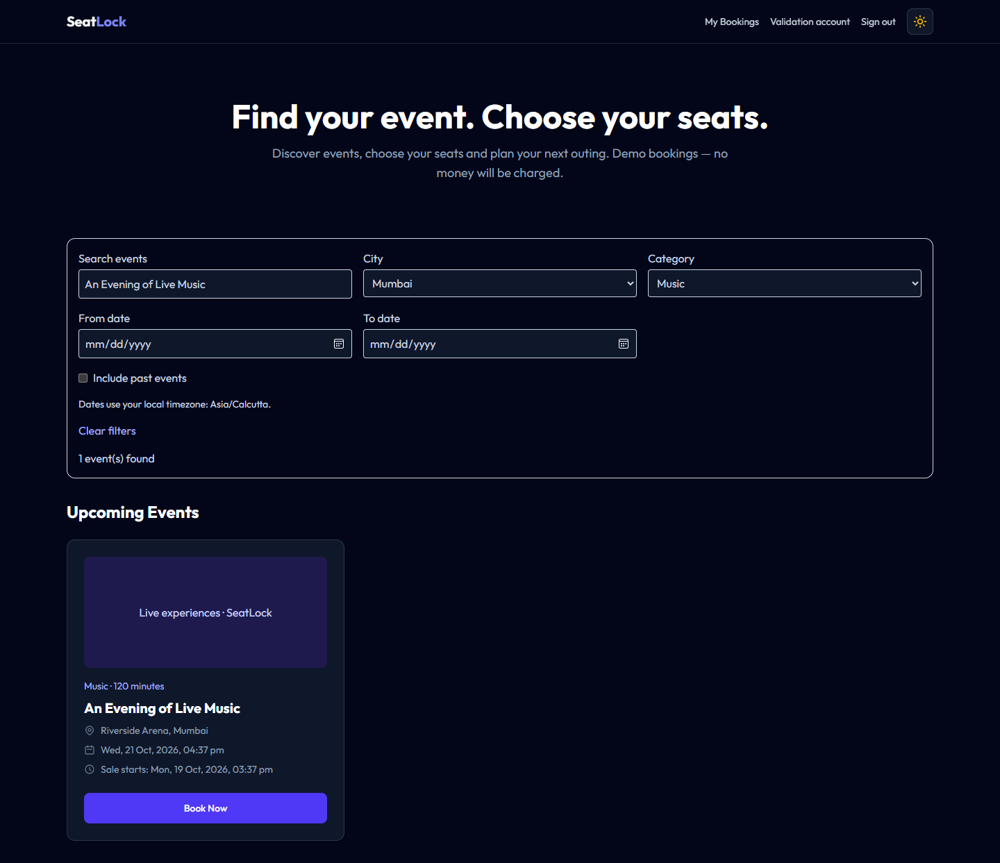
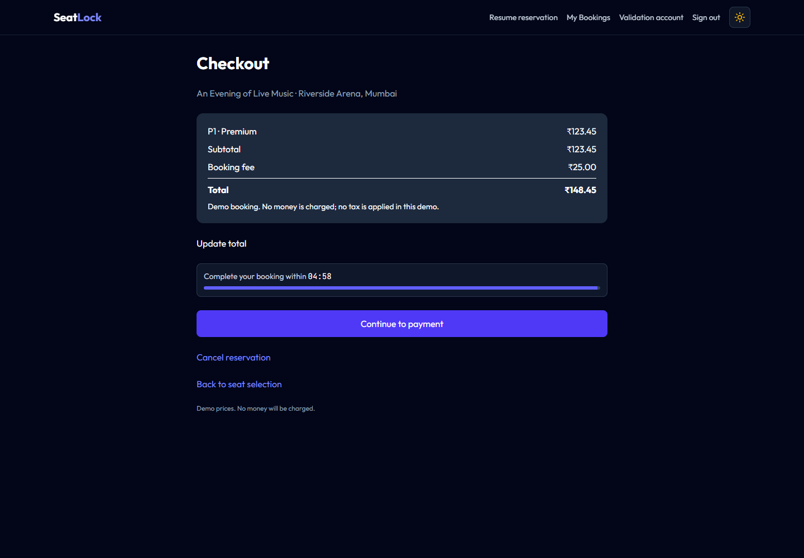
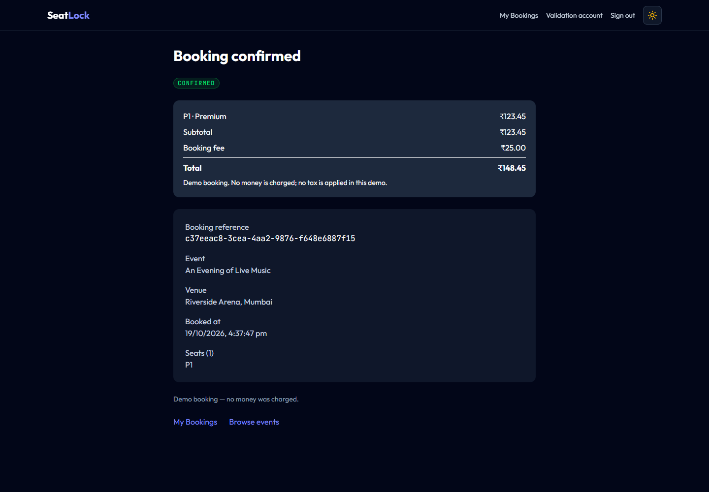

# SeatLock demo evidence

These screenshots show an automated **local packaged-stack rehearsal on 19 October 2026**, using synthetic records and simulated payments. They do not establish a public deployment or concurrency benchmark.

The backend ran with a 512 MiB container cap. Five catalogue/booking checks passed; see [the report](local-rehearsal.json). Observed memory snapshots were approximately 336 MiB after startup and 355 MiB during the run, not measured peak usage. The local test does not reproduce Render's CPU/network conditions or managed-service TLS connections.

## Event discovery

## Checkout

## Saved receipt after refresh

The three screenshots were visually reviewed. Raw admin/customer WebM captures are kept under ignored `frontend/test-results/demo-videos/`; they still need pacing/narration review before publication. Public deployment evidence and a final walkthrough link will be added after cloud validation. No live URL is claimed here.
